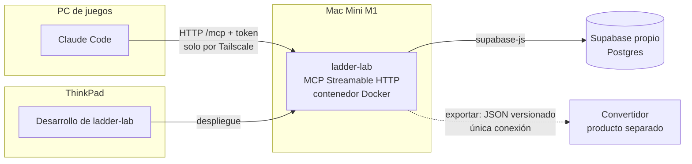
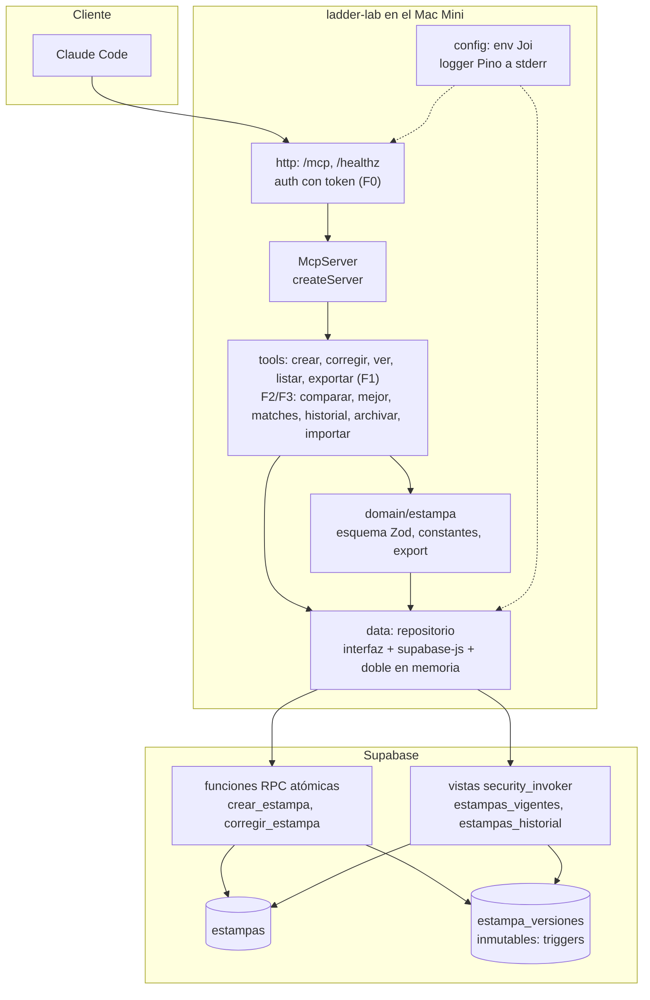

# Diagramas de Componentes (Flowcharts)

Propósito: mapa estable del sistema. Actualizar solo si cambia topología.

## Contexto (alto nivel)

La ubicación de Supabase (nube o local en el Mac) está abierta: punto 1 de [`../backlog/README.md`](../backlog/README.md).

## Componentes principales

Fronteras: el servidor es la única pieza que habla con Supabase; el cliente nunca recibe la clave de servicio; el convertidor solo ve JSON.
